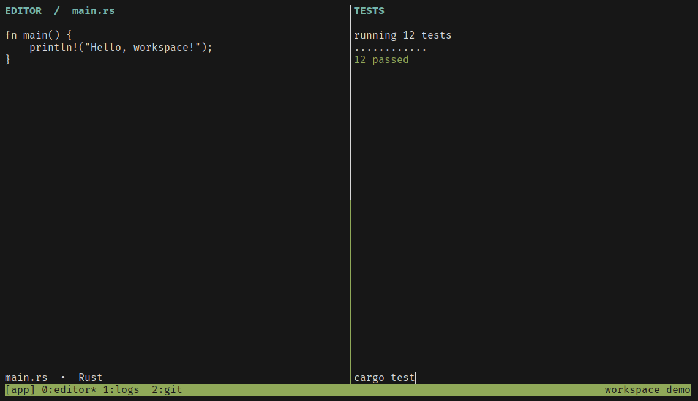

<div align="center">
  <h1>tmux-workspace-expose</h1>
  <p><strong>See your tmux workspace before you switch.</strong></p>
  <p>
    English · <a href="README.zh-CN.md">简体中文</a>
  </p>
  <p>
    <a href="#quick-start">Quick start</a> ·
    <a href="#keyboard-shortcuts">Shortcuts</a> ·
    <a href="#settings">Settings</a> ·
    <a href="#agent-status">Agent status</a>
  </p>
</div>



[Overview screenshot](assets/screenshot.png) · [Settings screenshot](assets/custom-example.png)

## What you can do

- **Browse sessions and windows.** Press `Alt+e` to see all sessions and their window thumbnails, or `Alt+w` to open the current session's window overview. Each window card shows pane previews in their actual split layout.
- **Set your grid size.** Limit the rows and columns for session and window cards independently. Use the arrow keys or mouse wheel to reach cards beyond the first screen.
- **Manage your workspace.** Fuzzy-search sessions, rename a session or window, or close one after confirmation.
- **Customize the interface.** Switch between Simplified Chinese and English, and adjust the grid, popup, colors, and refresh intervals.
- **See which agents need you.** Session cards show agents that are working, waiting, or need attention. You can bring sessions that need input to the front.

## Quick start

You need Git, Bash, Cargo, and tmux. This project was tested with Alacritty and tmux 3.4 on Linux.

```bash
git clone https://github.com/Nobody-Cares-TXSL/tmux-workspace-expose.git
cargo install --locked --path ./tmux-workspace-expose
```

The Cargo package is called `tmux-workspace-expose`. It installs a `tmux-expose` command that must be on the tmux server's `PATH`.

### Install with TPM

Add this line to your tmux configuration if you use [TPM](https://github.com/tmux-plugins/tpm). Replace your `cesarferreira/tmux.expose` entry if you already use the original plugin.

```tmux
set -g @plugin 'Nobody-Cares-TXSL/tmux-workspace-expose'
```

Reload your tmux configuration, press the prefix key followed by uppercase `I`, then press `Alt+e` to open the overview. TPM updates the plugin script. To update the binary as well, run `cargo install --locked --path .` from the updated checkout.

### Load manually

Add this line to your tmux configuration and substitute your checkout path.

```tmux
run-shell 'bash ~/src/tmux-workspace-expose/tmux.expose.tmux'
```

If tmux cannot find the binary, set its path before loading the plugin.

```tmux
set -g @tmux-expose-command '~/.cargo/bin/tmux-expose'
```

## Keyboard shortcuts

| Key | Action |
| --- | --- |
| `Alt+e` | Open the session overview. Press again to close the popup with the default binding. |
| `Alt+w` | Open the window overview for the current session. |
| `Ctrl+,` / `Shift+F12` | Open settings. |
| Arrow keys | Move the selection. |
| Mouse wheel | Scroll by row. |
| Left click | Select a session or window card. Press `Enter` to open or switch to it. |
| `Tab` / `Shift+Tab` | Move to the next or previous window card. |
| `Enter` | Open the selected session or switch to the selected window. |
| `q` | Close the popup while browsing. |
| `Ctrl+C` | Quit without switching. |
| `Esc` | Return from the window overview, cancel a dialog or settings edit, or clear the current session filter. |
| `/` then type | Filter sessions by fuzzy name. For example, `pf` can match `project-frontend`. |
| `Backspace` while searching | Delete the last character. |
| `Ctrl+W` while searching | Delete the previous word. |
| `Ctrl+U` while searching | Clear the query and keep editing. |
| `r` | Rename the selected session or window. Press `Enter` to save. |
| `d` | Open a close confirmation. Press `Enter` to close or `Esc` to cancel. |

With Vim navigation enabled, use `hjkl` to move. While editing a nonempty search, the first `Esc` stops editing and keeps the filter. Press `Esc` again in the session overview to clear it.

Closing a window linked to multiple sessions removes it from all of them.

### Map Ctrl+, in Alacritty

With tmux 3.4, `Shift+F12` opens settings directly. To use `Ctrl+,` in Alacritty, add this binding to `alacritty.toml`.

```toml
[[keyboard.bindings]]
key = ","
mods = "Control"
chars = "\u001B[24;2~"
```

## Settings

Press `Tab` or click a tab to switch settings pages. Select a field with the mouse or `↑` / `↓`. Type a value or adjust it with `←` / `→`. Press `Enter` to save or `Esc` to discard changes.

### Grid

| Setting | Values / Default | What it changes |
| --- | --- | --- |
| Session columns | 1–12 / 2 | Maximum number of session cards per row. |
| Session rows | 1–12 / 2 | Maximum number of session rows per screen. |
| Window columns | 1–12 / 2 | Maximum number of window cards per row. The same limit applies to thumbnails inside session cards. |
| Window rows | 1–12 / 2 | Maximum number of window rows per screen. |
| Card gap | 0–3 / 1 | Number of terminal cells between cards. |

A two-column, two-row session grid fits up to four cards per screen. Smaller terminals may fit fewer cards. Scroll to see the rest.

### Popup

| Setting | Values / Default | What it changes |
| --- | --- | --- |
| Launch key | `M-e` | Key that opens the session overview. `M-` means Alt and `C-` means Ctrl. The `prefix` key table also accepts a single letter. `M-w` and `C-c` are reserved. |
| Key table | `root`, `prefix` / `root` | `root` uses the key directly. `prefix` requires the tmux prefix first. |
| Width | 1–100% or 1–1000 cells / `100%` | Popup width, for example `80%`. |
| Height | 1–100% or 1–1000 cells / `100%` | Popup height. |
| Anchor | `center`, `top`, `bottom`, `left`, `right` / `center` | Places the popup in the center or along an edge. |
| Popup background | Color or `default` / `default` | Background color of the tmux popup. |
| Popup border | Color or `default` / `default` | Border color of the tmux popup. |
| Vim navigation | `on`, `off` / `off` | Enables `hjkl` navigation and keeps the filter when leaving search input. |

Size, anchor, and popup colors take effect the next time the popup opens. The dedicated settings shortcut always opens a full-size popup, so you can recover from an overly small size.

### Colors

Use a color name, `colour0` through `colour255`, or `#RRGGBB`.

| Setting | Default | What it changes |
| --- | --- | --- |
| Selected card | `yellow` | Highlight for the selected card. |
| Current session | `green` | Color of the session you are attached to. |
| Regular card | `white` | Title color for other session cards. |
| Agent needs attention | `#ff5555` | Badge color for an agent that needs you to act. |
| Agent waiting | `#ffb86c` | Badge color for an agent waiting for input. |
| Agent working | `#8be9fd` | Badge color for an agent working on a task. |

### Behavior

| Setting | Values / Default | What it changes |
| --- | --- | --- |
| Interface language | `zh`, `en` / `zh` | Switches between Simplified Chinese and English as soon as you save. |
| Agent priority sorting | `on`, `off` / `on` | `on` puts sessions that need attention or input first. `off` keeps the tmux list order. Badges still appear. |
| Layout refresh | 1–60000 ms / `1500` | How often the app reads the session, window, and pane layout and agent statuses. |
| Background pane refresh | 1–60000 ms / `1500` | How often pane previews refresh in unselected sessions. |
| Active pane refresh | 1–60000 ms / `300` | How often the active pane preview refreshes in the selected window. |
| Max captures per batch | 1–32 / `4` | Maximum number of pane previews captured in parallel per batch. |

Grid settings live in `$XDG_CONFIG_HOME/tmux-expose/grid.conf`. Other settings live in `appearance.conf` in the same directory. If `XDG_CONFIG_HOME` is unset, the base directory is `~/.config`. Saved settings take precedence over the corresponding startup options. `--columns` can still override the session column count for one launch.

When the terminal resizes, the popup reopens at the new size and restores the selected item. If a layout read or pane capture fails, the plugin keeps the available previews and retries.

## Agent status

Status is recorded on the tmux pane that runs the command and summarized in the session overview. Run these commands manually or let an agent hook update the badge.

| Command | Status |
| --- | --- |
| `tmux-expose agent-status working` | The agent is working on a task. |
| `tmux-expose agent-status waiting` | The turn ended and the agent is waiting for your next prompt. |
| `tmux-expose agent-status attention` | The agent is waiting for permission or another action. |
| `tmux-expose agent-status clear` | Clear the status on this pane. |

For example, set a pane to `waiting` and press `Alt+e`. The session card will show the waiting badge.

### Claude Code setup

Add this to `~/.claude/settings.json` for all projects or to a project's `.claude/settings.json` for that project. If you already have a `hooks` block, append the entries below to the matching event arrays and keep your existing hooks.

```json
{
  "hooks": {
    "UserPromptSubmit": [
      { "hooks": [{ "type": "command", "command": "tmux-expose agent-status working" }] }
    ],
    "Stop": [
      { "hooks": [{ "type": "command", "command": "tmux-expose agent-status waiting" }] }
    ],
    "PostToolUse": [
      {
        "matcher": "",
        "hooks": [{ "type": "command", "command": "tmux-expose agent-status working" }]
      }
    ],
    "Notification": [
      {
        "matcher": "permission_prompt",
        "hooks": [{ "type": "command", "command": "tmux-expose agent-status attention" }]
      }
    ],
    "SessionEnd": [
      {
        "matcher": "",
        "hooks": [{ "type": "command", "command": "tmux-expose agent-status clear" }]
      }
    ]
  }
}
```

Restart Claude Code or start a new session inside tmux, then run `/hooks` to verify the five events. Check that `tmux-expose --version` runs in the same terminal. If you installed the binary to a custom path, replace `tmux-expose` in the example with the executable's absolute path. [Claude Code hooks reference](https://code.claude.com/docs/en/hooks)

For other agents, run the same `tmux-expose agent-status <status>` commands from an available hook, lifecycle script, or wrapper in the corresponding tmux pane.

## Credits and license

Based on Cesar Ferreira's [tmux.expose](https://github.com/cesarferreira/tmux.expose). This project retains the original copyright notice and [MIT license](LICENSE).
