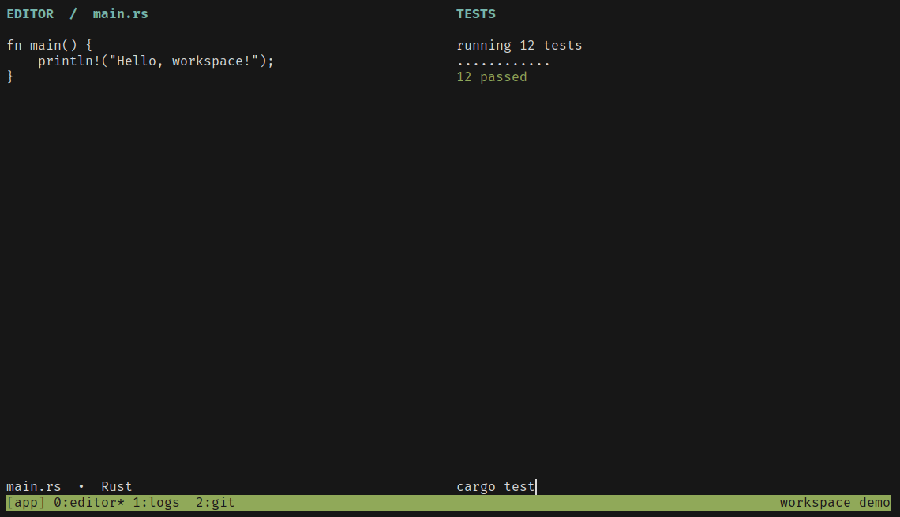

<div align="center">
  <h1>tmux-workspace-expose</h1>
  <p><strong>在切换之前，看清 tmux 工作区。</strong></p>
  <p>
    <a href="README.md">English</a> · 简体中文
  </p>
  <p>
    <a href="#快速开始">快速开始</a> ·
    <a href="#快捷键">快捷键</a> ·
    <a href="#设置项与取值">设置</a> ·
    <a href="#agent-状态提醒">Agent 状态提醒</a>
  </p>
</div>



[总览截图](assets/screenshot.png) · [设置截图](assets/custom-example.png)

## 功能概览

- **两级总览**。按 `Alt+e` 浏览所有 Session 和各自的 Window 缩略图，按 `Alt+w` 直达当前 Session 的 Window 总览。每张 Window 卡片按实际分屏布局显示 Pane 预览。
- **可滚动网格**。分别设置 Session 和 Window 每屏最多显示几行几列。用方向键或鼠标滚轮查看超出一屏的卡片。
- **工作区管理**。模糊搜索 Session，重命名或确认关闭选中的 Session 和 Window。
- **双语设置**。切换中英文界面，调整网格、弹窗、配色和刷新频率。
- **Agent 状态**。在 Session 卡片上查看运行、等待和需要处理的状态，也可以把待处理的 Session 排到前面。

## 快速开始

需要 Git、Bash、Cargo 和 tmux。本项目在 Linux 的 Alacritty 和 tmux 3.4 上验证过。

```bash
git clone https://github.com/Nobody-Cares-TXSL/tmux-workspace-expose.git
cargo install --locked --path ./tmux-workspace-expose
```

Cargo 包名为 `tmux-workspace-expose`，安装后的命令为 `tmux-expose`。确保 tmux 服务能从 `PATH` 找到它。

### 使用 TPM

如果使用 [TPM](https://github.com/tmux-plugins/tpm)，在 tmux 配置中加入以下内容。已有上游插件配置时，替换原来的 `cesarferreira/tmux.expose` 项。

```tmux
set -g @plugin 'Nobody-Cares-TXSL/tmux-workspace-expose'
```

重新加载 tmux 配置，按前缀键再按大写 `I` 安装插件，然后按 `Alt+e` 打开总览。TPM 会更新插件脚本。要同步更新二进制，请从更新后的项目目录运行 `cargo install --locked --path .`。

### 手动加载

把下面的示例路径改为实际克隆路径，再加入 tmux 配置。

```tmux
run-shell 'bash ~/src/tmux-workspace-expose/tmux.expose.tmux'
```

如果 tmux 找不到二进制，在加载插件前指定实际路径。

```tmux
set -g @tmux-expose-command '~/.cargo/bin/tmux-expose'
```

## 快捷键

| 按键 | 动作 |
| --- | --- |
| `Alt+e` | 打开 Session 总览，默认再次按下关闭弹窗 |
| `Alt+w` | 直接打开当前 Session 的 Window 总览 |
| `Ctrl+,` / `Shift+F12` | 打开设置 |
| 方向键 | 移动选中项 |
| 鼠标滚轮 | 逐行滚动 |
| 鼠标左键 | 选中 Session 或 Window 卡片，按 `Enter` 进入或切换 |
| `Tab` / `Shift+Tab` | 在 Window 总览中向前或向后选择 |
| `Enter` | 进入选中的 Session，或切换到选中的 Window |
| `q` | 浏览时关闭弹窗 |
| `Ctrl+C` | 退出弹窗，不切换工作区 |
| `Esc` | 从 Window 总览返回，取消对话框或设置编辑，或清除当前 Session 筛选 |
| `/` 后输入文字 | 按 Session 名称模糊筛选，例如 `pf` 可匹配 `project-frontend` |
| 搜索时按 `Backspace` | 删除最后一个字符 |
| 搜索时按 `Ctrl+W` | 删除上一个词 |
| 搜索时按 `Ctrl+U` | 清空查询并继续编辑 |
| `r` | 重命名选中的 Session 或 Window，按 `Enter` 保存 |
| `d` | 显示关闭确认，按 `Enter` 关闭，按 `Esc` 取消 |

开启 Vim 导航后，用 `hjkl` 移动。编辑非空查询时，第一次按 `Esc` 会结束编辑并保留筛选。在 Session 总览再按一次即可清除筛选。

如果同一个 Window 链接到了多个 Session，关闭它会移除所有链接。

### Alacritty 的 Ctrl+, 映射

tmux 3.4 可直接用 `Shift+F12` 打开设置。如需在 Alacritty 使用 `Ctrl+,`，在 `alacritty.toml` 中加入以下配置。

```toml
[[keyboard.bindings]]
key = ","
mods = "Control"
chars = "\u001B[24;2~"
```

## 设置项与取值

打开设置后，按 `Tab` 或点击页签切换页面，用 `↑` / `↓` 或鼠标选中字段。可以直接输入，也可以用 `←` / `→` 调整。按 `Enter` 保存，按 `Esc` 放弃修改。

### 网格

| 设置项 | 取值 / 默认 | 作用 |
| --- | --- | --- |
| Session 列数 | 1–12 / 2 | 总览每行最多显示多少张 Session 卡片。 |
| Session 行数 | 1–12 / 2 | 总览一屏最多显示几行。 |
| Window 列数 | 1–12 / 2 | Window 卡片每行的上限，Session 卡片里的缩略图也使用这个上限。 |
| Window 行数 | 1–12 / 2 | Window 卡片每屏的行数上限。 |
| 卡片间距 | 0–3 / 1 | 相邻卡片之间留多少终端字符格。 |

例如 Session 设为 2 列、2 行时，一屏最多显示 4 张卡片。终端过窄或过矮时，一屏会显示更少，剩余卡片仍可滚动查看。

### 弹窗

| 设置项 | 取值 / 默认 | 作用 |
| --- | --- | --- |
| 启动键 | `M-e` | 打开 Session 总览的按键。 `M-` 表示 Alt，`C-` 表示 Ctrl。 `prefix` 按键表也可用单个字母。 `M-w` 和 `C-c` 保留。 |
| 按键表 | `root`、`prefix` / `root` | `root` 直接按键，`prefix` 先按 tmux 前缀键。 |
| 宽度 | 1–100% 或 1–1000 个字符格 / `100%` | 决定弹窗横向占用的空间，例如 `80%`。 |
| 高度 | 1–100% 或 1–1000 个字符格 / `100%` | 决定弹窗纵向占用的空间。 |
| 停靠 | `center`、`top`、`bottom`、`left`、`right` / `center` | 决定弹窗居中或靠哪一边。 |
| 弹窗背景 | 颜色或 `default` / `default` | 设置 tmux 弹窗的背景。 |
| 弹窗边框 | 颜色或 `default` / `default` | 设置 tmux 弹窗外框的颜色。 |
| Vim 导航 | `on`、`off` / `off` | 开启后支持 `hjkl` 和保留筛选的搜索模式。 |

宽高、停靠、背景和边框在下次打开弹窗时生效。独立的设置快捷键始终打开全尺寸设置页，方便把过小的尺寸改回来。

### 配色

颜色可以输入名称、`colour0` 到 `colour255`，或 `#RRGGBB`。

| 设置项 | 默认 | 作用 |
| --- | --- | --- |
| 选中卡片 | `yellow` | 当前选中项的高亮颜色。 |
| 当前 Session | `green` | 当前连接的 Session 卡片颜色。 |
| 普通卡片 | `white` | 其他 Session 卡片的标题颜色。 |
| Agent 需处理 | `#ff5555` | Agent 遇到需要人工处理事项时的标记颜色。 |
| Agent 等待 | `#ffb86c` | Agent 等待回复时的标记颜色。 |
| Agent 运行中 | `#8be9fd` | Agent 工作时的标记颜色。 |

### 行为

| 设置项 | 取值 / 默认 | 作用 |
| --- | --- | --- |
| 界面语言 | `zh`、`en` / `zh` | 切换简体中文或英文，保存后立即更新。 |
| Agent 优先排序 | `on`、`off` / `on` | `on` 把需要处理或等待回复的 Session 排到前面，`off` 保留 tmux 的列表顺序。Agent 标记仍会显示。 |
| 布局刷新 | 1–60000 毫秒 / `1500` | 多久重新读取 Session、Window、Pane 的结构和 Agent 状态。 |
| 后台 Pane 刷新 | 1–60000 毫秒 / `1500` | 未选中 Session 的 Pane 预览多久更新一次。 |
| 活跃 Pane 刷新 | 1–60000 毫秒 / `300` | 当前选中 Window 的活跃 Pane 预览多久更新一次。 |
| 每批最多抓取 | 1–32 / `4` | 一批最多同时抓取多少个 Pane 的画面。 |

网格设置保存在 `$XDG_CONFIG_HOME/tmux-expose/grid.conf`，其余保存在同目录下的 `appearance.conf`。未设置 `XDG_CONFIG_HOME` 时使用 `~/.config`。已保存的值优先于对应的启动参数，`--columns` 仍可覆盖当次启动的 Session 列数。

终端缩放后，弹窗会按新尺寸打开并恢复选中项。读取布局或画面失败时，插件会保留可用的预览并重试。

## Agent 状态提醒

状态记录在运行命令的 tmux Pane 上，Session 总览会汇总标记。可以手动运行以下命令，也可以让 Agent 的 hook 自动更新状态。

| 命令 | 状态 |
| --- | --- |
| `tmux-expose agent-status working` | Agent 正在处理任务 |
| `tmux-expose agent-status waiting` | 当前轮次已结束，等待你的下一条指令 |
| `tmux-expose agent-status attention` | 正在等你确认权限或处理其他事项 |
| `tmux-expose agent-status clear` | 清除当前 Pane 的状态 |

例如，在一个 Pane 里标记 `waiting`，再按 `Alt+e`，对应的 Session 卡片会提示它在等待回复。

### Claude Code 设置

把以下配置加入 `~/.claude/settings.json`（适用于所有项目）或项目的 `.claude/settings.json`（仅当前项目）。如果已有 `hooks`，把下面的条目追加到同名事件的数组中，保留原有配置。

```json
{
  "hooks": {
    "UserPromptSubmit": [
      { "hooks": [{ "type": "command", "command": "tmux-expose agent-status working" }] }
    ],
    "Stop": [
      { "hooks": [{ "type": "command", "command": "tmux-expose agent-status waiting" }] }
    ],
    "PostToolUse": [
      {
        "matcher": "",
        "hooks": [{ "type": "command", "command": "tmux-expose agent-status working" }]
      }
    ],
    "Notification": [
      {
        "matcher": "permission_prompt",
        "hooks": [{ "type": "command", "command": "tmux-expose agent-status attention" }]
      }
    ],
    "SessionEnd": [
      {
        "matcher": "",
        "hooks": [{ "type": "command", "command": "tmux-expose agent-status clear" }]
      }
    ]
  }
}
```

保存后，在 tmux 中重启 Claude Code 或开启一个新会话，再用 `/hooks` 核对这五个事件。确认在启动 Claude Code 的终端里能运行 `tmux-expose --version`。如果二进制用了自定义路径，把示例中的 `tmux-expose` 换成实际可执行文件的绝对路径。 [Claude Code hooks 文档](https://code.claude.com/docs/en/hooks)

其他 Agent 可以通过各自的 hook、生命周期脚本或启动包装器，在对应的 tmux Pane 中运行相同的 `tmux-expose agent-status <状态>` 命令。

## 来源与许可证

本项目基于 Cesar Ferreira 的 [tmux.expose](https://github.com/cesarferreira/tmux.expose) 二次开发，保留上游版权声明和 [MIT 许可证](LICENSE)。
